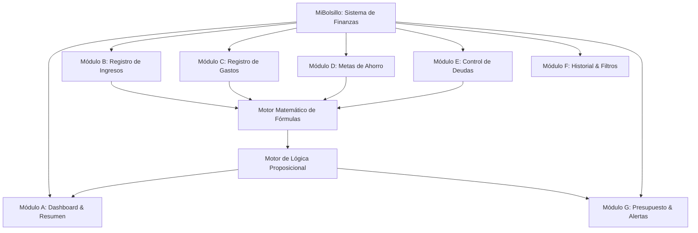

# MIBOLSILLO: INFORME ACADÉMICO Y REVISIÓN TÉCNICA

**Prototipo para la gestión y el control de las finanzas personales**  
*Programa de Ingeniería de Sistemas — Primer Semestre*  
*Asignatura: Fundamentos de Programación / Algoritmos y Estructuras I*  
*Moneda de referencia: pesos colombianos (COP)*  
*Alcance: revisión del código y documentación existentes; no certifica el sistema para uso financiero real.*

---

## 1. Ficha Técnica del Proyecto

| Parámetro | Detalle |
| :--- | :--- |
| **Nombre del Proyecto** | Prototipo Informático para la Gestión y Control de las Finanzas Personales (**MiBolsillo**) |
| **Nivel Académico** | Primer Semestre — Ingeniería de Sistemas |
| **Paradigma** | Programación estructurada y modular |
| **Tecnologías Implementadas** | **C++17** (aplicación independiente de consola) y **HTML5 / CSS3 / JavaScript** (interfaces web PC y móvil); Chart.js para gráficos cuando la CDN está disponible |
| **Unidad Monetaria** | Peso Colombiano ($ COP) |
| **Almacenamiento** | Datos en memoria durante la ejecución de C++; estado web guardado localmente como JSON en `localStorage` |
| **Entradas web** | `index.html` (PC), `desktop.html` (PC) y `mobile.html` (móvil) |
| **Núcleo web** | `shared.js`; controladores `desktop.js` y `mobile.js` |

---

## 2. Introducción y Justificación

La organización de los recursos personales puede apoyarse en el registro y análisis de ingresos, gastos, ahorro y deudas. MiBolsillo modela estos datos mediante colecciones, operaciones aritméticas y reglas condicionales, y los presenta en interfaces web y de consola.

El proyecto es un prototipo académico, no un servicio bancario ni una herramienta contable certificada. La aplicación web permite persistir datos en el navegador; el programa C++ es independiente, mantiene los datos en memoria y no sincroniza con la web.

---

## 3. Objetivos del Software

### 3.1 Objetivo General
Diseñar y desarrollar un prototipo informático funcional para la administración, registro y diagnóstico de las finanzas personales de una persona natural, mediante algoritmos estructurados, modelado matemático contable e interfaces intuitivas.

### 3.2 Objetivos Específicos
1. **Captura estructurada:** Registrar ingresos y gastos con concepto, valor, categoría y fecha.
2. **Metas de ahorro:** Crear objetivos, acumular aportes y representar el avance con un máximo visual de 100%.
3. **Gestión de deudas:** Registrar obligaciones y abonos, manteniendo el saldo pendiente no negativo.
4. **Consulta de movimientos:** Buscar y filtrar movimientos mediante las opciones disponibles en cada interfaz.
5. **Presupuestos y alertas:** Comparar gastos del período seleccionado con el presupuesto y mostrar alertas lógicas.

---

## 4. Estructura de Módulos del Sistema



### Módulos de la aplicación web
* **Inicio:** saldo disponible global, ingresos y gastos del período, presupuesto, alertas y movimientos recientes.
* **Registro e historial:** alta de movimientos, búsqueda y filtros por tipo; PC ofrece opciones adicionales de consulta.
* **Plan:** presupuesto del período y desglose de gastos por categoría.
* **Metas y deudas:** tarjetas de objetivos y obligaciones, con formularios para aportes y abonos.
* **Informes:** balance del período, tasa de ahorro basada en las metas y gráficos construidos a partir de los movimientos existentes.
* **Perfil:** edición de nombre, correo y saldo inicial, además de opciones de exportación.

Las cantidades precargadas son datos demostrativos, no datos de una persona real. Los montos se presentan en COP con separador de miles y dos decimales. Con el estado inicial web de octubre de 2026, las cifras son: ingresos de **3.200.000,00 COP**, gastos de **1.840.500,00 COP**, flujo del período de **1.359.500,00 COP**, presupuesto mensual de **2.300.000,00 COP** (aproximadamente **80 %** consumido), ahorro en metas de **2.750.000,00 COP** y tasa de ahorro global aproximada de **85,9 %**. El saldo inicial configurado es cero, por lo que el saldo disponible global inicial también es **1.359.500,00 COP**.

### 4.1 Arquitectura de Código Separada (Versión PC vs. Versión Móvil):
La aplicación web separa la interfaz del estado y la lógica compartida:
* **Núcleo (`shared.js`):** mantiene movimientos, metas, deudas, preferencias, saldo inicial y período seleccionado. Guarda el estado en `localStorage` bajo la clave `FINANZAS_ETAPA_DATA_V2` y notifica cambios entre pestañas del mismo navegador. Los campos monetarios aceptan centavos y, al salir de cada campo, normalizan la entrada a dos decimales; los valores de la aplicación también se presentan con dos decimales.
* **Escritorio (`desktop.html`, `desktop.css`, `desktop.js`):** navegación lateral, paneles de resumen, formularios, tablas, gráficos y exportación.
* **Móvil (`mobile.html`, `mobile.css`, `mobile.js`):** interfaz adaptada a un viewport móvil, navegación inferior y formularios tipo modal.
* **Entrada `index.html`:** carga el núcleo compartido y el controlador de escritorio; es una alternativa de entrada PC.
* **Consola (`main.cpp`):** aplicación C++ separada; no actúa como backend de la web ni comparte su almacenamiento.

Las páginas web cargan Chart.js y fuentes desde servicios CDN externos. Si Chart.js no está disponible, la interfaz puede omitir los gráficos o mostrar un aviso; no se debe describir la aplicación como completamente autónoma o garantizada sin conexión.

---

## 5. Fundamentación Matemática y Casos Borde

El núcleo web distingue cálculos del período seleccionado y cálculos globales. Las cifras de demostración de este informe corresponden al estado web precargado, salvo que se indique lo contrario.

### 5.1 Fórmulas Matemáticas

1. **Ingresos Totales ($I_T$):**
   $$I_T = \sum_{i=1}^{n} \text{ingreso}_i$$
   *Control de borde:* Si $n = 0$, $I_T = 0$.

2. **Gastos Totales ($G_T$):**
   $$G_T = \sum_{j=1}^{m} \text{gasto}_j$$
   *Control de borde:* Si $m = 0$, $G_T = 0$.

3. **Flujo neto del período ($F_P$):**
   $$F_P = I_P - G_P$$
   donde $I_P$ y $G_P$ son los ingresos y gastos del período seleccionado. Un flujo negativo representa déficit en ese período.

4. **Saldo disponible global ($S$):**
   $$S = S_0 + I_G - G_G$$
   donde $S_0$ es el saldo inicial explícito y configurable, e $I_G$ y $G_G$ son los ingresos y gastos de todos los períodos. El estado inicial usa $S_0=0$ COP. No se incorporan automáticamente ahorro en metas ni pasivos a esta fórmula.

5. **Ahorro acumulado en metas ($A_T$):**
   $$A_T = \sum_{k=1}^{p} \text{aporte}_k$$
   En la web, el acumulado usado en la tasa es la suma de los saldos actuales de las metas. El historial de aportes se conserva por separado; la aplicación no deduce automáticamente los abonos a metas del flujo de movimientos. En C++, el ahorro acumulado se obtiene de los aportes guardados en la meta única de la consola. Por tanto, la fórmula tiene el mismo propósito, pero los modelos y las cifras de ambas aplicaciones no son directamente equivalentes.

6. **Tasa de ahorro respecto a ingresos globales ($T_A$):**
   $$T_A = \begin{cases} 
   \left( \frac{A_T}{I_T} \right) \times 100 & \text{si } I_T > 0 \\ 
   0.0\% & \text{si } I_T \le 0 
   \end{cases}$$
   Se usa el total global de ingresos, no solo el del mes seleccionado. La tasa puede superar el 100 % si el saldo registrado en metas excede los ingresos registrados; por tanto, no equivale al flujo neto ni necesariamente a una tasa de ahorro del mismo período.

7. **Saldo pendiente de una deuda ($S_d$):**
   $$S_d = \max\left( V_{\text{inicial}} - \sum_{r=1}^{q} \text{abono}_r, \; 0 \right)$$
   En la web el saldo se actualiza al registrar cada abono y el historial conserva el valor aplicado. En C++ el saldo se calcula restando la suma de abonos al valor inicial.

8. **Porcentaje de avance visual de una meta ($Av$):**
   $$Av = \begin{cases}
   \min\left( \left( \frac{A_T}{M_{\text{ahorro}}} \right) \times 100, \; 100.0\% \right) & \text{si } M_{\text{ahorro}} > 0 \\ 
   0.0\% & \text{si } M_{\text{ahorro}} \le 0 
   \end{cases}$$
   El avance visual se limita al 100 %, pero el saldo real de la meta y el historial de aportes pueden superar el objetivo.

9. **Dinero faltante para la meta ($F_M$):**
   $$F_M = \max(M_{\text{ahorro}} - A_T, \; 0)$$

---

### 5.2 Claridad Conceptual: Diferencia entre Dinero Disponible y Ahorro Acumulado

> [!IMPORTANT]
> **Principio de Integridad Contable (No Conteo Doble):**
> 
> * **Flujo neto del período ($F_P$):** diferencia entre los movimientos tipificados como ingresos y gastos durante el período seleccionado.
> * **Saldo disponible global ($S$):** saldo inicial más ingresos menos gastos a lo largo del historial. Es una estimación basada únicamente en esos registros.
> * **Ahorro acumulado ($A_T$):** saldo indicado en las metas. Se presenta separadamente; las aportaciones no se descuentan automáticamente del saldo global ni se convierten en gastos.
>
> No se debe sumar el ahorro a metas al saldo global sin modelar transferencias entre cuentas: hacerlo podría contar dos veces el mismo dinero. El prototipo tampoco descuenta automáticamente deudas o aportes del saldo global.

---

## 6. Mapeo de Conceptos de Primer Semestre de Ingeniería de Sistemas

| Concepto Académico | Implementación en C++ (`main.cpp`) | Implementación web |
| :--- | :--- | :--- |
| **1. Programación estructurada y modular** | Funciones para cálculos, registro, historial, ahorro, deudas y presupuesto. | `FinanzasCore` en `shared.js`, con controladores separados en `desktop.js` y `mobile.js`. |
| **2. Variables y tipos de datos** | `double`, `std::string`, `int` y `bool`. | `Number`, `String`, `Array` y `Boolean`. |
| **3. Colecciones y estructuras** | `struct Movimiento`, `struct MetaAhorro` y `struct Deuda`, agrupados mediante `std::vector`. | Objetos y arreglos de objetos para movimientos, metas, deudas e historiales. |
| **4. Condicionales** | `if`, `else` y `switch` para validación, alertas y menú. | `if / else` para validaciones, estados y presentación. |
| **5. Ciclos y agregación** | Bucles para recorrer y sumar vectores; `do-while` para el menú. | `filter`, `reduce`, `forEach` y bucles para filtrar, agregar y renderizar. |
| **6. Operaciones matemáticas** | Sumatorias, balances, tasas y límites con `std::min` / `std::max`. | Operaciones numéricas y límites con `Math.min` / `Math.max`. |
| **7. Lógica proposicional** | Conectores `&&` y `||` para el diagnóstico financiero. | Condiciones compuestas para alertas y controles presupuestales. |

### Ejemplo de Lógica Proposicional en el Código:

$$\text{Alerta Crítica} = (G_T > I_T) \lor (P_{\text{mensual}} > 0 \land G_T \ge P_{\text{mensual}})$$

En C++:
```cpp
bool pDeficit = (gastos > ingresos);
bool pPresupuestoExcedido = (presupuesto > 0.0 && gastos > presupuesto);

if (pDeficit || pPresupuestoExcedido) {
    // Alerta de máxima prioridad
}
```

---

## 7. Instrucciones de Compilación y Ejecución

El proyecto incluye interfaces web y un programa de consola independientes:

### Opción 1: Prototipo Web Interactivo (Recomendado para Demostración Visual)
1. Abra `index.html` para la interfaz PC o `mobile.html` para la interfaz móvil. También puede iniciar `iniciar_aplicacion.bat` y elegir la opción 1 (PC) o 2 (móvil).
2. Las páginas funcionan en un navegador moderno. Los datos web se conservan en `localStorage` del mismo navegador y perfil.
3. Chart.js y las fuentes tipográficas se solicitan desde CDN; para gráficos y tipografías externas se requiere conexión. Si Chart.js no está disponible, las funciones de gráficos tienen degradación parcial.

### Opción 2: Prototipo Académico de Consola en C++
1. Abra una terminal de comandos en la carpeta del proyecto.
2. Compile con GCC/MinGW ejecutando:
   ```bash
   g++ -std=c++17 -Wall -Wextra main.cpp -o finanzas.exe
   ```
3. Ejecute la aplicación:
   ```bash
   .\finanzas.exe
   ```
4. También puede usar `iniciar_aplicacion.bat` y seleccionar la opción 3 para ejecutar la consola. La opción 2 abre la interfaz móvil.

La aplicación C++ carga datos de demostración en cada ejecución y los cambios no persisten al cerrar el programa. No comparte datos con las interfaces web.

---

## 8. Guía de Sustentación para la Evaluación Universitaria

Preguntas frecuentes que realizan los docentes en primer semestre y argumentos técnicos para responder:

1. **¿Por qué el prototipo usa `double` para montos en C++ y `Number` en JavaScript?**
   * *Respuesta:* Son tipos numéricos de punto flotante apropiados para ejercicios y cálculos demostrativos; pueden introducir errores de redondeo. Para una aplicación contable de producción se deberían usar unidades enteras mínimas o un tipo decimal adecuado y especificar reglas de redondeo.

2. **¿Cómo se evita dividir por cero en las tasas y avances?**
   * *Respuesta:* Las fórmulas comprueban que el denominador sea positivo antes de dividir y devuelven cero cuando no hay ingresos u objetivo válido.

3. **¿Qué sucede si una meta recibe aportes superiores al objetivo?**
   * *Respuesta:* La web conserva el importe real aportado en el saldo e historial; solo limita al 100 % la barra visual de progreso.

4. **¿Cómo se controlan los abonos que exceden una deuda?**
   * *Respuesta:* En la web, el importe aplicado se ajusta al saldo pendiente y el historial registra el importe aplicado. El saldo no baja de cero.

---

## 9. Revisión técnica del estado actual

La siguiente revisión describe el comportamiento observado en el código; no implica que se hayan corregido todos los puntos pendientes.

### 9.1 Mejoras presentes en el código actual

* La web cuenta con selección de mes, saldo inicial como dato del núcleo, cálculos de movimientos por período y agregación mensual de gráficos a partir del historial.
* Las altas principales tienen validación de concepto, monto y tipo en el núcleo; los aportes y abonos mantienen historiales, y un abono mayor que la deuda se limita al saldo pendiente.
* La consola C++ detecta fin de entrada en el menú y en varias lecturas, evitando quedar atrapada en el ciclo del menú cuando la entrada estándar termina.
* La web conserva estado en `localStorage` y escucha cambios de almacenamiento entre pestañas del mismo navegador. Esto no constituye sincronización entre dispositivos ni una copia de seguridad remota.

### 9.2 Hallazgos y estado de corrección, ordenados por impacto

1. **Corregido: interpolación de datos en manejadores HTML.** Las acciones dinámicas PC y móvil usan delegación de eventos y atributos `data-*`; los valores se escapan para el contexto de atributo. No quedan atributos dinámicos `onclick` en las plantillas de movimientos, categorías, metas y deudas.
2. **Corregido: referencias compartidas al cargar estado parcial.** `_validarArray()` ahora clona los arreglos predeterminados, evitando que una operación modifique `INITIAL_STATE` y que `resetState()` restaure registros introducidos después de cargar datos incompletos.
3. **Corregido: validación y lectura de fechas de movimientos.** `agregarMovimiento()` ahora valida tanto el formato `AAAA-MM-DD` como la fecha real del calendario, incluidos los días bisiestos; el parser también descarta fechas inválidas ya guardadas en lugar de normalizarlas.
4. **Corregido: aislamiento de presupuestos por período.** `actualizarPresupuesto()` ya no modifica el presupuesto mensual predeterminado al guardar el límite del período seleccionado. Los meses sin valor específico conservan el predeterminado.
5. **Corregido: edición del saldo inicial.** Los formularios PC y móvil exponen el campo con precisión de centavos. Los controladores solo actualizan el saldo inicial si el campo existe y contiene un número válido, evitando reemplazarlo por cero al editar el resto del perfil.
6. **Las preferencias de alertas están desconectadas o incompletas.** Las dos casillas de la sección Plan PC llaman al mismo controlador de presupuesto; la segunda no modifica los recordatorios de deuda. El núcleo lee `recordatoriosDeudas`, pero no produce alertas de vencimiento. Los identificadores esperados por algunos controladores de preferencias no existen en las páginas HTML actuales, y la página móvil tampoco muestra controles para esas preferencias.
7. **Corregido: conciliación de datos demostrativos.** Se agregaron registros históricos a las metas y deudas para que la suma de aportes coincida con los saldos guardados y la suma de abonos coincida con la amortización indicada.
8. **Corregido: período de movimientos recientes y CSV.** Los listados recientes y las exportaciones PC/móvil usan los movimientos del período seleccionado; el nombre del archivo identifica ese período. El monto en el CSV usa dos decimales.
9. **Subtítulos estáticos pueden quedar desactualizados.** Algunas comparaciones y mensajes de resumen en HTML están escritos como texto fijo y no se recalculan con los datos del usuario. Aunque los valores principales sí se actualizan, esos textos auxiliares pueden contradecirlos tras cambios.
10. **Estructura redundante y rutas antiguas.** `index.html` y `desktop.html` son dos entradas PC distintas que cargan los mismos scripts, pero su contenido diverge. `app.js` permanece en la carpeta, pero no lo carga ninguna de las tres páginas actuales. Esto puede confundir el mantenimiento y hacer que se edite una ruta que no usa la aplicación.
11. **Precisión y presentación monetaria.** La web muestra montos con dos decimales y permite ingresar centavos en campos numéricos (`step=0.01`). La consola C++ conserva su modelo independiente, no persiste datos y usa `double`.
12. **Persistencia y dependencias.** `localStorage` puede borrarse o fallar por restricciones/cuota; el guardado informa el error en consola, pero no muestra una recuperación en la interfaz. La web depende de Chart.js y fuentes externas de CDN.

### 9.3 Resultados cuantitativos revisados

Con el estado web de demostración observado, los indicadores se mantienen: ingresos globales de **3.200.000,00 COP**, gastos de **1.840.500,00 COP**, saldo global calculado de **1.359.500,00 COP**, metas por **2.750.000,00 COP** y presupuesto predeterminado de **2.300.000,00 COP**. Las sumas de los historiales de aportes y abonos ahora coinciden con los saldos y amortizaciones precargados.

### 9.4 Validaciones ejecutadas para esta revisión

* `node --check` para `shared.js`, `desktop.js`, `mobile.js` y `app.js`: **correcto**.
* Compilación de sintaxis C++17 con `g++ -std=c++17 -Wall -Wextra -fsyntax-only main.cpp`: **correcta**.
* Pruebas de regresión en Node.js: **correctas** para estado parcial/restablecimiento, validación de fechas, presupuestos por período, presentación con centavos y conciliación de los datos demostrativos.
* Comprobación estática: los campos monetarios `type=number` de PC, móvil e `index.html` aceptan pasos de `0.01`; los formularios de perfil contienen sus campos de saldo inicial.
* Revisión estática: no quedan interpolaciones de datos en `onclick`/`onchange`/`oninput` en plantillas dinámicas; las acciones usan atributos `data-*` y listeners delegados.
* Pruebas en navegador PC y móvil: mostraron valores con dos decimales; al guardar el perfil con el saldo inicial vacío, ambos conservaron el valor existente. Se comprobó además el funcionamiento de una categoría PC y de la acción dinámica para abrir el modal de aporte móvil.
* Prueba de escape en navegador con comillas y caracteres HTML: el valor se conservó en `data-*`, no creó elementos adicionales y la acción generada no tuvo `onclick` inline. También se comprobó que el listado reciente del PC queda vacío al seleccionar un mes sin movimientos.
* No se ejecutaron pruebas completas de accesibilidad ni flujos de descarga CSV en navegador.

---

## 10. Ampliación del Sistema: Módulo de Gestión Empresarial y Base de Datos MySQL

### 10.1 Alcance y Justificación de la Ampliación
El sistema se amplió de un prototipo estrictamente personal a un **Sistema Integral de Finanzas Personales y Gestión Empresarial**. Esta evolución permite a los usuarios administrar simultáneamente su economía doméstica y uno o varios pequeños negocios o emprendimientos (panaderías, talleres, manufactura, comercio o servicios) manteniendo la contabilidad estrictamente aislada.

### 10.2 Acceso desde "Mi Perfil" y Conmutador de Módulos
1. **Nuevo apartado en "Mi Perfil" (`view-perfil`):** Se implementó una tarjeta heroica destacada con el botón interactivo **`🏢 Entrar a Gestión Empresarial →`**, que presenta métricas en tiempo real del negocio activo (Ventas, Utilidad Neta, Cartera por Cobrar).
2. **Conmutador en Sidebar:** Barra superior en el menú lateral con dos opciones: `[ 👤 Personal ]` y `[ 🏢 Negocios ]`. Permite alternar de manera fluida entre la gestión personal y la empresarial.

### 10.3 Submódulos Empresariales Implementados (14 Vistas)
1. **Dashboard Empresarial:** KPIs en vivo (Ventas, Costo de Ventas COGS, Gastos Operativos, Utilidad Neta con margen %, Cuentas por Cobrar, Valor en Bodega), alertas de stock y últimas facturas.
2. **Mi Negocio:** Configuración del negocio activo y soporte para registrar y alternar entre múltiples empresas/sucursales.
3. **Productos Terminados:** Catálogo para venta con cálculo automático de margen sobre costo unitario.
4. **Materias Primas:** Insumos para fabricación con unidad de medida (kg, L, uds) y costo de adquisición.
5. **Inventario & Kardex:** Existencias en tiempo real, alertas de stock mínimo y trazabilidad de movimientos.
6. **Compras & Abastecimiento:** Adquisición a proveedores; al confirmar la compra, el inventario se incrementa automáticamente (Regla 1).
7. **Producción & Recetas:** Fórmulas de fabricación que validan insumos disponibles, descuentan materias primas consumidas, aumentan el producto terminado y calculan el costo unitario real de producción (Regla 6).
8. **Proveedores:** Directorio comercial con contactos e historial.
9. **Ventas & Facturación:** Registro de ventas de contado y a crédito, con validación de stock (Reglas 2, 3 y 4).
10. **Clientes:** Cartera de clientes y seguimiento de saldos deudores.
11. **Créditos & Cobranzas:** Gestión de ventas pendientes y registro de abonos parciales o totales con reducción automática de deuda (Regla 5).
12. **Empleados & Nómina:** Registro de personal, asignación de cargos, salarios y comprobantes de nómina.
13. **Gastos Operativos:** Arriendo, servicios, mantenimiento y fletes, aislados de las finanzas personales (Regla 7).
14. **Ganancias & Estado de Resultados (P&L):** Cálculo formal de Utilidad Bruta = Ventas - COGS y Utilidad Neta = Utilidad Bruta - Gastos Operativos (Regla 9).

### 10.4 Modelo de Datos Relacional MySQL (`database/gestor_financiero.sql`)
Se diseñó y proveyó el script SQL completo con 19 tablas relacionales en tercera forma normal (3FN), claves primarias compuestas, claves foráneas con integridad referencial en cascada, índices de optimización, disparadores (*triggers*) para automatizar el kardex y validaciones de stock:
* **Generales:** `usuario`, `persona_natural`, `negocio`.
* **Finanzas Personales:** `cuenta_personal`, `categoria_personal`, `movimiento_personal`, `presupuesto`, `meta_ahorro`, `aporte_meta`, `deuda_personal`, `pago_deuda`.
* **Gestión Empresarial:** `producto`, `proveedor`, `cliente`, `compra`, `detalle_compra`, `venta`, `detalle_venta`, `pago_venta`, `gasto_negocio`, `empleado`, `pago_empleado`, `movimiento_inventario`, `formula_producto`, `detalle_formula`, `produccion`.

### 10.5 Arquitectura C++ / Qt6 / QML (`qt_app/`)
Para cumplir los requerimientos de desarrollo en C++ y Qt:
* **Capa de Datos:** `DatabaseManager` con `QSqlDatabase` (driver `QMYSQL`), transacciones atómicas y consultas preparadas con `bindValue()`.
* **Capa de Negocio:** `BusinessService` y `PersonalFinanceService` con métodos `Q_INVOKABLE`.
* **Capa de Presentación:** Interfaz declarativa en QML (`main.qml`, `ProfileView.qml`, `BusinessModule.qml`).

---

## 11. Refactorización y Modularización Arquitectónica del Sistema

### 11.1 Justificación y Objetivos
El crecimiento funcional del sistema integró 14 submódulos empresariales y múltiples características personales avanzadas. Para evitar que el software se convirtiera en una aplicación monolítica difícil de mantener, se llevó a cabo una **refactorización integral de la arquitectura**, guiada por los principios de:
1. **Responsabilidad Única (SRP - Single Responsibility Principle):** Cada archivo tiene un único propósito bien delimitado.
2. **Separación de Capas:** Aislamiento estricto entre almacenamiento, lógica pura de dominio, controladores de eventos, modales, formularios y renderizado de vistas.
3. **Bajo Acoplamiento y Alta Cohesión:** Módulos independientes que pueden ser probados, extendidos o reemplazados sin afectar otras partes del sistema.
4. **Compatibilidad Retroactiva Total:** Preservación del 100% de los identificadores, selectores del DOM, contratos de API (`Finanzas.*`, `pcApp.*`) y funcionamiento idéntico tanto para la versión de escritorio como móvil.

### 11.2 Estructura Modular de Directorios

```
src/
├── utils/                           # Funciones auxiliares puras y validaciones
│   ├── formatters.js               # Formato de moneda COP, porcentajes e iniciales
│   ├── dates.js                    # Fechas ISO, meses, períodos y parseo local sin desfases
│   ├── security.js                 # Prevención de XSS y desinfección de inyecciones CSV
│   └── validators.js               # Validaciones de montos, inputs numéricos y requeridos
│
├── storage/                        # Capa de persistencia y estado base
│   ├── seedData.js                 # Catálogos maestros, categorías de ingresos/gastos
│   ├── demoData.js                 # Estado inicial completo con datos de prueba realistas
│   ├── localStorage.js             # Adaptador de persistencia segura y cuotas en localStorage
│   └── migrations.js               # Normalización y evolución de esquemas de datos
│
├── domains/                        # Lógica de negocio pura (independiente de la UI)
│   ├── personal/                   # Dominio: Finanzas Personales
│   │   ├── movementsDomain.js      # CRUD de movimientos, balance y totales por mes
│   │   ├── budgetDomain.js         # Presupuestos por categoría, consumo y alertas (80%, 100%)
│   │   ├── goalsDomain.js          # Metas de ahorro, aportes y porcentajes
│   │   └── debtsDomain.js          # Deudas, cuotas mensuales y amortización de pagos
│   │
│   ├── business/                   # Dominio: Gestión Empresarial
│   │   ├── businessDomain.js       # CRUD de empresas y conmutación de negocio activo
│   │   ├── productsDomain.js       # Catálogo de productos y materias primas, cálculo de márgenes
│   │   ├── inventoryDomain.js      # Existencias en bodega, alertas de stock mínimo y Kardex
│   │   ├── purchasesDomain.js      # Compras e incremento automático de stock (Regla 1)
│   │   ├── salesDomain.js          # Ventas, descuento de stock (Reglas 2-3) y COGS real (Regla 9)
│   │   ├── creditsDomain.js        # Cartera a crédito y reducción de saldos por abonos (Reglas 4-5)
│   │   ├── productionDomain.js     # Fórmulas/recetas y fabricación de lotes (Regla 6)
│   │   ├── employeesDomain.js      # Directorio de personal, salarios y liquidación de nómina
│   │   ├── expensesDomain.js       # Gastos operativos clasificados y aislados (Regla 7)
│   │   ├── metricsDomain.js        # Estado de resultados P&L, utilidad bruta y neta (Regla 9)
│   │   └── cashFlowDomain.js       # Posición de caja, cuentas bancarias y flujo neto
│   │
│   └── user/                       # Dominio: Usuario
│       └── userService.js          # Metadatos del perfil, privacidad y preferencias
│
├── services/                       # Orquestación y servicios globales
│   ├── exportService.js            # Exportación a CSV sanitizado y respaldos JSON
│   └── finanzasCore.js             # Fachada FinanzasCore y orquestador central reactivo
│
└── ui/                             # Capa visual y controladores de usuario
    ├── charts/                     # Gráficos y analítica visual
    │   ├── chartService.js         # Wrapper Chart.js y gestión del ciclo de vida de lienzos
    │   ├── personalCharts.js       # Historial de ingresos vs gastos y dona por categoría
    │   └── businessCharts.js       # Ventas vs COGS, flujo semanal de caja y dona de gastos
    │
    ├── filters/                    # Filtros y búsquedas
    │   ├── searchFilter.js         # Atajo global de búsqueda (Ctrl + K)
    │   ├── personalFilters.js      # Filtros de movimientos por texto, categoría y tipo
    │   └── businessFilters.js      # Pestañas y búsqueda para ventas, compras e inventario
    │
    ├── modals/                     # Diálogos y modales
    │   ├── modalManager.js         # Apertura, cierre accesible, atajos Escape y backdrop
    │   ├── personalModals.js       # Modales de movimientos, metas, deudas y presupuestos
    │   └── businessModals.js       # Modales de ventas, compras, productos, nómina y gastos
    │
    ├── forms/                      # Controladores de formularios
    │   ├── personalForms.js        # Handlers submit de finanzas personales
    │   └── businessForms.js        # Handlers submit y cálculos dinámicos de líneas de detalle
    │
    ├── views/                      # Renderizadores de vistas dedicadas
    │   ├── personal/               # Vistas personales (Dashboard, Movimientos, Plan, Metas, Deudas, Informes, Perfil)
    │   └── business/               # Vistas empresariales (Dashboard, Productos, Inventario, Compras, Ventas, Proveedores, Créditos, Empleados, Gastos, Reportes, Caja, Mi Negocio)
    │
    └── desktop/
        └── desktopApp.js           # Orquestador DesktopApp (navegación, breadcrumbs, toasts)
```

### 11.3 Archivos Rediseñados como Fachadas de Compatibilidad
* `src/utils/desktop.js`: De un monolito de 3.139 líneas pasó a un punto de entrada conciso (25 líneas) que delega en `src/ui/desktop/desktopApp.js` y expone `window.pcApp`.
* `src/utils/shared.js`: De un archivo masivo de 2.463 líneas pasó a un puente de compatibilidad (50 líneas) que re-exporta los catálogos y funciones en el espacio global para garantizar funcionamiento con scripts existentes y la versión móvil.


