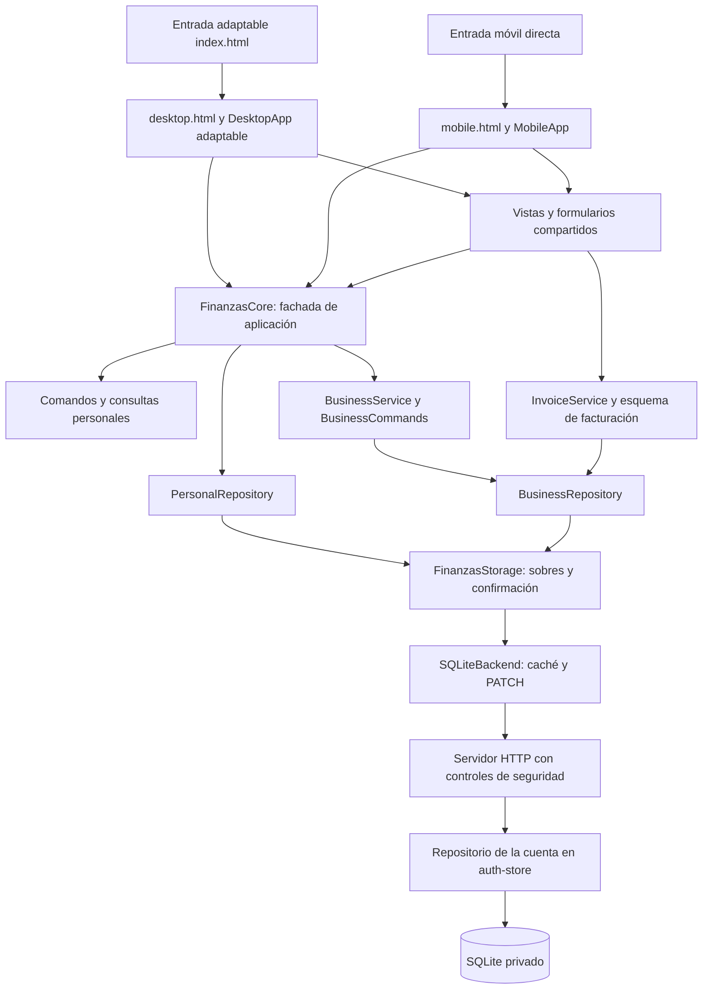
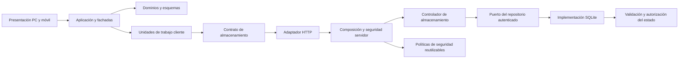
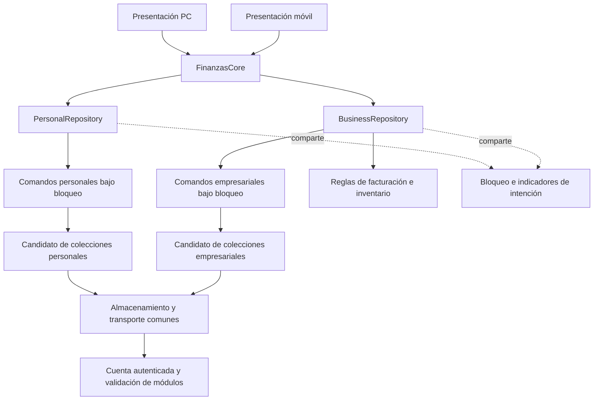
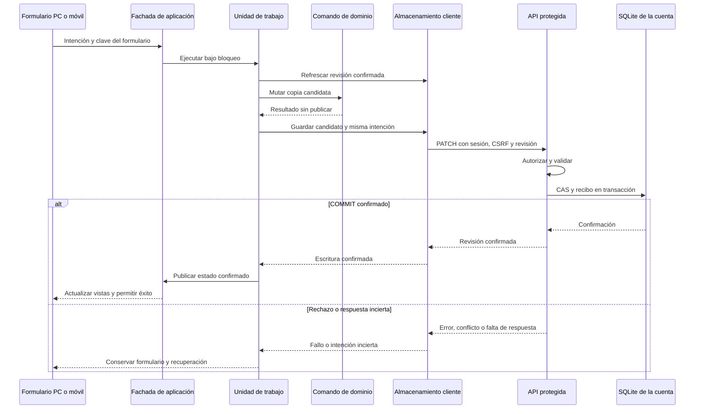
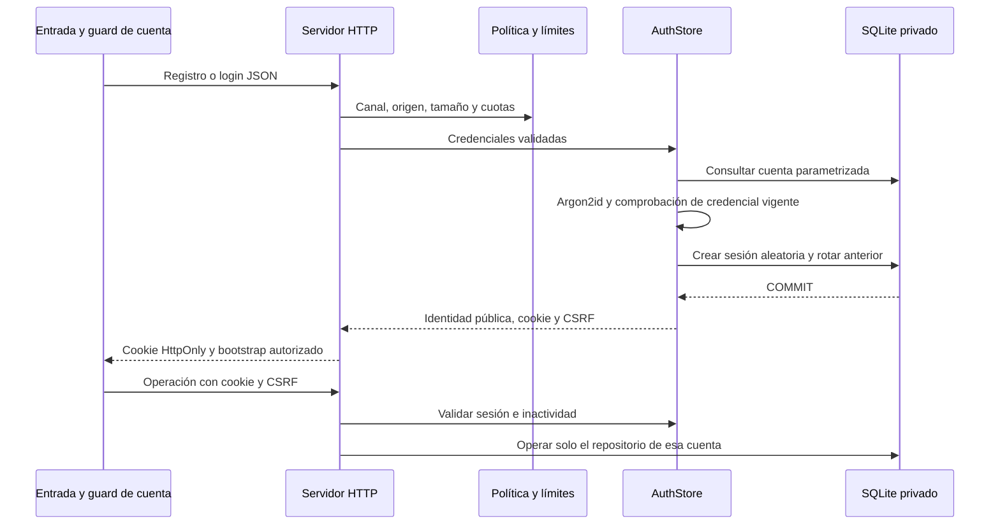

# Arquitectura de MiBolsillo

Estado verificado en fase 4, 27 de noviembre de 2026. La aplicación conserva scripts clásicos, Node.js, SQLite y las interfaces actuales. Es una arquitectura modular progresiva; no una reescritura completa de Clean Architecture.

El [mapa de archivos](ESTRUCTURA_PROYECTO.md) indica qué editar. La [auditoría de fase 4](AUDITORIA_FASE_4.md) contiene diagnóstico, métricas, pruebas y límites. Las medidas operativas pendientes siguen en la [auditoría de seguridad](AUDITORIA_SEGURIDAD_FASE_3.md) y el [plan de exposición histórica](PLAN_RESPUESTA_EXPOSICION.md).

## Arquitectura general

La fachada coordina los comandos personales y su repositorio: el dominio recibe un candidato; no importa ni invoca persistencia. El backend usa la sesión para seleccionar el agregado de una cuenta. Las interfaces no acceden al archivo SQLite.

`index.html` abre siempre el mismo `desktop.html` en su marco: CSS adapta ese documento al ancho sin cambiar controlador, sesión o borrador. `mobile.html` conserva su entrada directa independiente; no existe una selección automática entre esos dos documentos al redimensionar.

## Capas y contratos

| Responsabilidad | Implementación real | Contrato |
|---|---|---|
| Presentación | Controladores `src/utils/desktop.js`, `mobile.js`, `src/ui/`, interfaz de facturación | Lee modelos, captura entradas, invoca casos de uso y muestra resultados. Conserva el diseño propio de cada dispositivo. |
| Aplicación | `FinanzasCore`, `BusinessService`, `InvoiceService`, normalizador de agregado y exportaciones | Coordina dominio y unidades de trabajo, conservando métodos públicos actuales. No elige identidad de servidor ni ejecuta SQL. |
| Dominio | `src/domains/personal/`, `business/`, `user/`, importes y esquemas de facturación | Entidades, comandos, cálculos, filtros y validaciones sin DOM, transporte ni WebStorage. Algunos modelos de lectura reciben una fachada por argumento. |
| Repositorios cliente | `PersonalRepository`, `BusinessRepository` | Bloqueo, refresco, candidato, validación, escritura y publicación confirmada. No son otro almacén financiero ni un motor SQLite. |
| Infraestructura cliente | `src/storage/localStorage.js`, `sqliteBackend.js` | Serialización, CAS, transporte PATCH, caché de revisión, errores y recuperación de una escritura incierta. |
| Composición servidor | `scripts/serve-sqlite.cjs` | Construye dependencias, aplica guardas globales, elige cuenta, enruta y sirve recursos públicos. Conserva los exports anteriores. |
| Adaptadores servidor | `scripts/backend/` | Transporte HTTP, controlador `/api/storage`, formato del sobre y apertura/repositorio legado SQLite. |
| Seguridad y persistencia de cuentas | `scripts/auth-store.cjs`, módulos de seguridad, validación y respaldos existentes | Autenticación, sesiones, autorización transaccional, SQL parametrizado por cuenta y copias privadas. No se descompusieron sus transacciones por reducir líneas. |

`sqlite-state-repository.cjs` abre la conexión y conserva `app_state` y sus vistas históricas. El repositorio actual por usuario sigue dentro de `auth-store.cjs` y comparte esa conexión. No se afirma que todo el SQL esté separado de autenticación: ese es un límite explícito de la transición.

No hay un contenedor de inyección de dependencias. Se usan argumentos, un puerto de almacenamiento, un consumidor de eventos y la composición actual de Node. Los nombres globales de navegador son contratos de compatibilidad, no una razón para agregar nuevos estados paralelos.

## Finanzas personales y negocio

`PersonalCommands` recibe `next` explícitamente y devuelve el resultado del comando. Sus cambios de deuda/abono/movimiento se realizan sobre el mismo candidato. No guarda, no actualiza el estado global y no conoce controles visuales. Los identificadores, el reloj, el redondeo y las reglas históricas se conservaron; no se presenta como una función matemáticamente pura o determinista.

Las metas y deudas normalizan sus entidades en sus dominios existentes. `FinanzasStateNormalizer` coordina el agregado, el presupuesto histórico y `BusinessSchema.migrate` sobre una copia, sin acceso a disco. No es una migración de datos reales ejecutada durante el desarrollo.

El negocio ya tenía comandos, servicio, repositorio, esquemas, modelos de lectura y vistas compartidas. Se mantiene esa separación para inventario, ventas, compras, contactos, empleados, producción, caja e informes. La facturación comparte su unidad de trabajo para que inventario, venta, pagos, consecutivos y bitácora confirmen juntos.

Compartir bloqueo y sobre no autoriza cruces entre dominios. Los comandos solo cambian sus colecciones y relaciones previstas. El servidor conserva validación de referencias, propietario, rol y negocios permitidos. Un bloqueo pendiente personal impide confirmar una intención empresarial distinta, y viceversa.

## Flujo de una operación financiera

El reintento incierto conserva clave, revisión y contenido. No se rebasa automáticamente sobre una revisión posterior. Un 409 exige revisar lo confirmado. SQLite y el recibo se confirman juntos; perder la respuesta no implica que el COMMIT haya sido revertido.

## Estado y sincronización

- **Datos persistidos:** SQLite del servidor, por sesión y `user_id`, es la autoridad del modo SQLite. `app_state` anterior es archivo legado sin asignación automática.
- **Proyección de trabajo:** `Finanzas.state` contiene la representación confirmada que consultan las interfaces. Un comando prepara una copia; las unidades de trabajo no la publican si guardar falla.
- **Transporte:** `FinanzasStorage` mantiene sobre/revisión esperada y pendientes; `SQLiteBackend` mantiene la caché de transporte y el comprobante incierto. No son cuentas nuevas ni almacenes independientes.
- **Publicación:** ambos repositorios y la sincronización llaman al puerto `publicarEstadoConfirmado`. `guardarEstado()` y restauración JSON heredada todavía conservan publicación directa: no se afirma centralización absoluta de rutas históricas.
- **Cambios externos:** `FinanzasStorage.subscribe(listener)` entrega copias de eventos `state` o `persistence` y devuelve cancelación. El adaptador ya no modifica directamente `window.Finanzas` ni el store opcional. La fachada decide cómo normalizar/publicar y mantiene el espejo compatible.
- **Fallos del consumidor:** un observador de estado que rechaza una revisión restaura la referencia anterior y bloquea la escritura obsoleta hasta reintentar; un error del observador de status no convierte un COMMIT confirmado en fallo.
- **Sesión:** cookie HttpOnly y validación del servidor; identidad y CSRF del bootstrap solo en memoria. Canales entre pestañas separados por cuenta. No hay sincronización entre equipos.
- **Formularios:** borradores solo en memoria, 15 minutos y misma cuenta; se descartan al cerrar/recargar. No se trasladaron a localStorage.

`MiBolsilloStore`/`MiBolsilloState` siguen como compatibilidad opcional; las páginas activas no crean un segundo store. Los escenarios estáticos/Android conservan el adaptador histórico de navegador y no se describen como SQLite nativo. La entrada con cuentas no desbloquea finanzas privadas cuando no hay API. Un fallo de SQLite nunca activa un fallback silencioso.

## Autenticación y seguridad

Origen/Host/proxy, sesión, cuenta discordante y cuotas se comprueban antes de delegar a `/api/storage`. El controlador conserva CSRF, Content-Type, tamaño, campos, revisión y validación. El repositorio por cuenta vuelve a autorizar dentro de la transacción. El manejador central espera al controlador asíncrono para sanear sus errores.

El backend permanece bajo `scripts/`, fuera de `src/`, estilos y paquete Android. Los recursos estáticos conservan la lista permitida y validación canónica contra symlinks/junctions. No se realizaron revocaciones o rotaciones administrativas reales. HTTPS operativo, CSP sin inline, enumeración de registro, cifrado y exposición histórica siguen pendientes de fase 3; reorganizar archivos no resuelve esos riesgos.

## Dependencias y crecimiento

Las pruebas de arquitectura verifican imports CommonJS relativos resueltos y sin ciclos, backend sin presentación, repositorio sin HTTP, dominios sin DOM/transporte/WebStorage y ausencia de backend en scripts públicos. También verifican límites de los controladores y contrato de suscripción. No son un analizador completo de dependencias dinámicas ni una certificación de toda complejidad.

Reglas para desarrollar:

1. Agregar una regla o comando a su dominio; recibir candidato y argumentos explícitos, sin UI, SQL, fetch ni estado global financiero paralelo.
2. Coordinar cambios relacionados en una unidad de trabajo existente. Conservar locks, validación, aislamiento y comprobación de persistencia; no guardar cada parte de un pago por separado.
3. Mantener la fachada pública compatible cuando ambos clientes la usan. Agregar solo el adaptador visual propio de cada dispositivo; reutilizar fechas, importes, errores, filtros, exportación y recuperación.
4. Registrar un módulo nuevo en el mismo orden compartido de ambos HTML, antes de su consumidor. Los fixtures y empaquetador leen las entradas reales; no agregar un índice global que oculte dependencias.
5. Si hay transporte o repositorio de servidor, colocarlo fuera de `src/` y conservar guards en la composición. La identidad procede de sesión; un selector del cliente no otorga permisos.
6. Añadir pruebas del contrato y de fallo/recarga en PC/móvil. Ejecutar la suite, seguridad, navegador y revisión del paquete Android. Nunca apuntar fixtures a bases reales.
7. Actualizar este documento y el mapa solo con módulos implementados. PostgreSQL/MySQL remotos, nuevas funciones, microservicios y nuevos frameworks no se implementaron en fase 4.

Se conservan módulos grandes cuando su extracción no resuelve un límite real: vistas empresariales, parte de la fachada, esquema/autenticación y adaptador de exportaciones. Una futura persistencia distinta deberá satisfacer los contratos de repositorio, autorización, CAS e idempotencia; no basta con sustituir la conexión SQLite.
