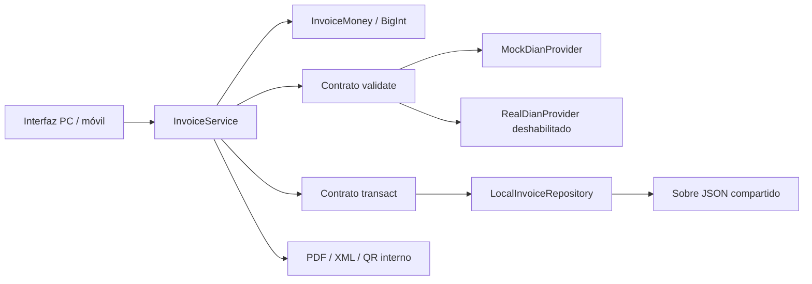

# Facturación simulada de Mi Negocio

Implementación local, revisión del 9 de noviembre de 2026. **SIMULACIÓN SIN VALIDEZ FISCAL**. No transmite documentos, genera CUFE/CUDE oficial, firma, resolución ni respuesta de autorización de la DIAN.

## Análisis de la arquitectura encontrada

Las entradas activas son `desktop.html` y `mobile.html`. Cargan scripts clásicos con dependencias explícitas, sin framework, empaquetador ni servidor de aplicación. Sus controladores son `src/utils/desktop.js` y `src/utils/mobile.js`. `FinanzasCore` coordina dominios personales y empresariales; el estado es un objeto compartido por negocio, con colecciones para productos, ventas, clientes, pagos y movimientos de inventario.

La persistencia activa es `src/storage/localStorage.js`, clave `FINANZAS_ETAPA_DATA_V2`, sobre JSON versionado con sincronización entre pestañas y detección preventiva de conflictos. El guardado anterior podía dejar operaciones en memoria para reintentarlas. Esa política se conserva para los flujos existentes; facturación prepara un candidato separado y solo lo publica después del guardado exitoso, sin dejar un guardado pendiente que pueda aplicar efectos inesperados después.

Las ventas existentes usan `Number` para sus cálculos y no tienen snapshots tributarios, estados de proveedor ni un contrato fiscal. El flujo de caja contiene cifras de demostración. Los reportes sumaban ingresos adicionales una vez por venta: se movió esa suma fuera del bucle para que añadir una factura no multiplicara ingresos existentes. Para documentos del módulo se usa la base sin impuestos como ingreso. Las otras ventas conservan su base previa.

Los archivos JavaScript de la raíz, C++/Qt y el esquema SQL histórico son implementaciones independientes. No se migraron ni conectaron. No se alteraron los dominios, formularios ni estilos de Finanzas Personales.

## Plan por fases y resultado

| Fase | Entrega | Estado |
| --- | --- | --- |
| 1 | Arquitectura, dinero decimal, contratos y estados | Implementada |
| 2 | Persistencia local atómica, idempotencia, snapshots e integración empresarial | Implementada dentro del alcance local descrito abajo |
| 3 | Dashboard, formulario, historial, filtros, consulta y cobros responsivos | Implementada |
| 4 | PDF, QR interno, XML experimental, notas crédito/débito | Implementada |
| 5 | Pruebas unitarias/integración y navegador, revisión visual del PDF | Ejecutada |
| 6 | Backend transaccional, autenticación, aislamiento de usuarios y almacenamiento remoto | Pendiente; no existe infraestructura configurada |
| 7 | XSD/reglas DIAN, firma, CUFE/CUDE, numeración autorizada, habilitación/producción | Pendiente; adaptador real deshabilitado |

## Uso

Sirva el proyecto en `localhost` o HTTPS con un navegador moderno que implemente Web Locks y Web Crypto. No use `file://`. PC: **Mi Negocio → Ventas → Facturación electrónica simulada**. Móvil: **Mi Negocio → Facturación electrónica simulada**.

1. Cree una factura, seleccione productos del catálogo empresarial y diligencie el cliente. Un nuevo cliente se incorpora al catálogo al confirmar. Los productos se administran desde Inventario/Productos.
2. Use punto decimal sin separadores de miles. Seleccione condición de pago, vencimiento, descuentos e impuestos. Los precios no incluyen impuestos.
3. Guarde un borrador o valide internamente. El proveedor simulado exige dirección y correo para aceptar. El rechazo guarda sus motivos y no crea venta ni movimiento de stock. Edite el borrador rechazado y vuelva a validar.
4. Consulte el documento para descargar PDF/XML, registrar cobros o preparar notas. Cada nota se guarda y valida por el mismo flujo que la factura.
5. El QR abre una URL de consulta en esta aplicación. Requiere el mismo origen, datos locales y negocio activo. No publica datos ni consulta un servicio oficial. Una URL `localhost` no da acceso al documento desde otro dispositivo.

Los filtros incluyen cliente/identificación, número/ID, fechas, estado y rango de total histórico. Los indicadores usan todos los documentos del negocio, independientemente del filtro del historial; ventas netas excluyen impuestos e incorporan notas confirmadas. Las facturas anuladas siguen contando como documentos confirmados históricos.

## Componentes y contratos



| Archivo | Responsabilidad |
| --- | --- |
| `src/invoicing/money.js` | Motor decimal puro, límites y redondeo |
| `schema.js` | Validación de estructura e invariantes al operar/restaurar |
| `providers.js` | Proveedores intercambiables sin efectos contables |
| `repository.js` | Copia candidata, bloqueo, sincronización y commit local |
| `service.js` | Permisos, idempotencia, consecutivos, snapshots, estados, contabilización y auditoría |
| `exports.js` | PDF binario paginado, XML y URL/QR internos |
| `ui.js`, `styles/invoicing.css` | Interfaz compartida con estilos limitados al diálogo |

El proveedor expone `validate(document): Promise<{accepted, source, errors}>`. El motor acepta únicamente respuestas con `source: INTERNAL_SIMULATION`. El proveedor no modifica inventario, ventas ni cartera. No interpreta aceptación interna como validación DIAN. Una excepción o timeout de 15 segundos produce rechazo interno recuperable.

El repositorio expone `transact(syncMutator)`: recibe una copia del estado y publica el candidato completo o lanza un error. Se inyecta como tercer argumento de `InvoiceService`; el proveedor es el segundo argumento. En el backend este puerto debe traducirse en comandos de negocio transaccionales, no aceptar estado arbitrario enviado por el navegador.

## Reglas financieras

- Todos los cálculos del motor son `BigInt`. Los valores persistidos del documento son cadenas decimales. No se usa `parseFloat`, multiplicación ni acumulación binaria para importes del documento.
- Cantidad, precio y costo unitario: hasta cuatro decimales. Tarifas y porcentajes: hasta dos. Dinero: dos decimales COP.
- HALF_UP para valores no negativos: `floor((numerador + denominador / 2) / denominador)`.
- Por línea: bruto = redondear(cantidad × precio); descuento = redondear(bruto × porcentaje / 100); base = bruto − descuento; impuesto = redondear(base × tarifa / 100). Los totales y grupos tributarios suman las líneas ya redondeadas. Costo = redondear(cantidad × costo histórico).
- Cantidad/precio positivos, descuentos entre 0 y 100, tarifa entre 0 y 100; exento/excluido con tarifa cero. Máximo 100 líneas y 1 billón COP por documento. Se rechazan exponentes, comas, infinitos y precisión excesiva.
- La interfaz ofrece IVA 19/5/0, exento, excluido e INC 8 como opciones de simulación; el usuario debe escoger el tratamiento correspondiente. No se ha implementado un clasificador tributario, retenciones, múltiples impuestos simultáneos por línea ni todo el catálogo de tributos DIAN.
- Solo en el límite de compatibilidad se convierten resultados finales a `Number` para las vistas y colecciones antiguas. Los documentos históricos y su motor conservan las cadenas exactas. Los reportes heredados siguen usando `Number`; no se presenta esta entrega como migración decimal de toda la aplicación.

## Estados, notas y efectos

`BORRADOR → EN_VALIDACION_SIMULADA → VALIDADA_INTERNA | RECHAZADA_INTERNA`.

Un rechazado puede editarse y volver a borrador. Los borradores usan revisión optimista para evitar sobrescribir otra edición. El consecutivo se reserva al iniciar la primera validación y no se recicla si hay rechazo. Prefijos internos por negocio/tipo: `SIM-FV`, `SIM-NC`, `SIM-ND`. El identificador `SIM-<UUID>` no es CUFE/CUDE. Los documentos emitidos no tienen edición ni eliminación directa.

Al aceptar una factura se registran exactamente una venta vinculada por `invoiceDocumentId`, las salidas de inventario agregadas por producto, el cliente y la cartera o pago inicial. Se comprueba el stock acumulado al confirmar, no solo al guardar el borrador. Las ventas existentes se mantienen como operaciones independientes; una factura del módulo crea su venta y no debe registrarse manualmente una segunda vez en el formulario anterior. No hay conversión de ventas históricas en facturas en esta entrega.

Los cobros actualizan venta y cliente y agregan un pago auditado. El formulario de cartera anterior remite al módulo para documentos vinculados. Las notas parciales son **ajustes monetarios**, no devoluciones físicas: ajustan base, impuesto, total y cartera de la venta vinculada, sin una nueva venta ni movimiento de inventario. La nota crédito no puede exceder las bases, impuestos o valor aún ajustables. Una nota débito aumenta el valor/cartera; no cobra dinero automáticamente.

La anulación automática usa una nota crédito total con los datos históricos exactos. Requiere factura sin notas confirmadas previas y productos aún disponibles en el catálogo. Su aceptación devuelve cantidades, elimina el costo de esa venta en reportes, concilia cartera, registra la devolución simulada del dinero previamente pagado y marca la factura `ANULADA`, referenciando la nota. Con notas previas se requieren ajustes parciales para conciliar; no se ofrece anulación automática de ese escenario.

Si un crédito reduce el valor por debajo de lo pagado, la diferencia se registra como devolución simulada en `facturacion.refunds`, visible en consulta y flujo de caja. La factura histórica nunca pierde sus importes originales; la proyección de venta conserva el valor ajustado. El flujo de caja anterior mantiene sus valores de demostración y añade una cuenta explícita de flujo simulado. No constituye conciliación bancaria.

Los reportes heredados atribuyen el valor neto ajustado a la fecha de la venta original. No constituyen un libro contable de ajustes por período; el historial de notas conserva la fecha efectiva para una futura contabilización por eventos.

## Atomicidad, concurrencia e idempotencia: alcance exacto

Cada operación del módulo prepara y valida una copia, escribe el sobre completo con una llamada a `localStorage.setItem` y solo después cambia el estado visible. Ante cuota agotada o conflicto no se publica una venta o stock parcial. No se deja un candidato fallido en la cola de reintentos de los módulos anteriores.

Web Locks serializa las operaciones de **facturación** entre pestañas del mismo origen. Dentro del bloqueo se refresca la versión persistida y se ejecuta la mutación sin esperas. El registro de idempotencia comparte el commit con los efectos: clave por negocio, huella SHA-256 del comando y referencia al resultado. La huella sirve exclusivamente para idempotencia, no es CUFE. La reserva de validación y su resultado son dos transacciones locales; `EN_VALIDACION_SIMULADA` permite recuperar una recarga o fallo intermedio sin contabilizar dos veces. Las respuestas de intentos anteriores no modifican un intento posterior.

**Límite pendiente del requisito de transacciones globales:** las escrituras de módulos heredados no usan Web Locks. `localStorage` no ofrece compare-and-swap transaccional entre todos los escritores, almacenamiento remoto, alta disponibilidad ni garantías frente a cierres del sistema operativo. La comprobación preventiva de revisiones existente reduce conflictos, pero no elimina una carrera con una venta/compra heredada simultánea. No se garantiza serialización global de esos módulos ni concurrencia multiusuario/multiequipo. Para ese alcance hace falta implementar la fase de backend; no basta cambiar el proveedor DIAN. No se deben usar estas garantías locales como autorización para operación fiscal o multiusuario en producción.

Los roles locales `PROPIETARIO_LOCAL` (predeterminado), `FACTURADOR` y `LECTOR` se verifican en el servicio; opcionalmente `usuario.facturacionNegocios` limita negocios. Protegen la navegación y las operaciones ordinarias, pero se pueden modificar con herramientas del navegador. **No son autenticación ni una frontera de seguridad.** La auditoría es persistente y consultable, no inmutable frente al propietario del almacenamiento. No se permite borrar negocios con documentos ni clientes con ventas vinculadas. Las copias JSON incluyen documentos y se validan antes de restaurar.

## Preparación para integración real

Referencias consultadas:

- [Documentación técnica DIAN: anexo de factura electrónica de venta 1.9 y caja de herramientas](https://micrositios.dian.gov.co/sistema-de-facturacion-electronica/documentacion-tecnica/).
- [Anexo técnico 1.9 publicado por la DIAN](https://www.dian.gov.co/impuestos/factura-electronica/Documents/Anexo-Tecnico-Factura-Electronica-de-Venta-vr-1-9.pdf).
- [Normativa DIAN](https://micrositios.dian.gov.co/sistema-de-facturacion-electronica/normatividad/).
- [Especificación OASIS UBL 2.1](https://docs.oasis-open.org/ubl/os-UBL-2.1/UBL-2.1.html).

El XML usa namespaces y elementos de `Invoice`, `CreditNote` y `DebitNote`, referencias, partes, líneas, descuentos, impuestos y totales. Está marcado `EXPERIMENTAL`: no se validó contra XSD ni reglas DIAN y usa un perfil interno de simulación, no un perfil oficial. Las unidades internas se conservan en la descripción y se usa `C62` como unidad experimental; la integración real debe mapear el catálogo oficial. El método de exportación rechaza solicitar clasificación conforme. **No hay documentos declarados conformes en esta versión.**

Antes de activar un proveedor real:

1. Implementar backend autenticado con autorización por usuario/negocio, persistencia relacional `NUMERIC`, copias remotas y auditoría protegida. Migrar los escritores empresariales al mismo límite transaccional; mantener aisladas las finanzas personales.
2. Crear restricciones únicas `(business_id, operation_key)`, `(business_id, document_kind, internal_sequence)`, `(business_id, document_id, posting_kind)` y claves foráneas de notas al documento del mismo negocio. Bloquear consecutivos y filas de stock en una transacción. Incluir venta, stock, cartera, pago y evento outbox en el mismo commit.
3. Procesar la outbox mediante workers idempotentes, guardar intentos/respuestas originales y usar revisiones del documento. Implementar reintentos con backoff, consulta de estado, clasificación de errores y conciliación de resultados inciertos. Evitar mantener una transacción de BD abierta durante una llamada DIAN.
4. Incorporar datos fiscales completos del emisor/adquirente, catálogos, tributos, unidades, códigos de notas, fecha/hora/zona, numeración autorizada y controles de vigencia/rango. Separar consecutivos internos de los autorizados.
5. Implementar generador UBL conforme y validación XSD + reglas de la versión oficial aplicable en la fecha de despliegue. Guardar versión del anexo/reglas con cada documento; no tratar la referencia 1.9 como garantía indefinida de vigencia.
6. Implementar CUFE de factura y CUDE de notas con entradas, formatos, algoritmo y vectores oficiales. Su puerto debe estar separado del ID/huella de simulación. No reutilizar el UUID ni la huella SHA-256 de idempotencia.
7. Firmar en backend con el certificado adecuado y gestión segura de claves; validar XML firmado. El navegador nunca debe contener claves privadas o credenciales.
8. Implementar transporte/proveedor autorizado, validación previa, respuestas oficiales, consulta, entrega y contingencias según la normativa aplicable. El dominio debe distinguir validación interna, envío y aceptación/rechazo oficial.
9. Configurar habilitación y producción separadamente; superar pruebas oficiales y operativas antes de habilitar producción. `RealDianProvider` admite los nombres de ambientes pero siempre falla de forma explícita; hoy no envía nada.

## Verificación

Sin instalar dependencias:

```sh
node --test tests/*.test.cjs
node test_shared.js
node test_dates.js
```

La suite de facturación cubre cálculos conocidos, redondeo/fracciones, rechazo de datos, límites, snapshots, filtros, persistencia/recarga, claves duplicadas, dos contextos/pestañas, stock insuficiente, errores de almacenamiento antes/después de validar, recuperación, permisos, notas, cobros, devolución, bloqueo de exportación conforme, XML/PDF/QR y compatibilidad con copias.

Suite opcional de navegador, con Playwright disponible:

```sh
node tests/invoicing.browser.cjs
```

Puede indicar `PLAYWRIGHT_MODULE` y `PLAYWRIGHT_CHROME` cuando se usa una instalación externa. La suite crea un servidor temporal, usa contextos aislados y no altera los datos de su navegador. Genera capturas/PDF/XML en `tmp/invoicing` (ignorado por Git). Se ejecutó con Chrome a 1440, 820 y 390 píxeles: formulario, confirmación, cobro, anulación, descarga, XML bien formado, consulta tras recarga y ausencia de desbordamiento global. Se renderizó el PDF con Poppler y se inspeccionaron las imágenes. Estas pruebas **no** son certificación DIAN ni una validación XSD.
