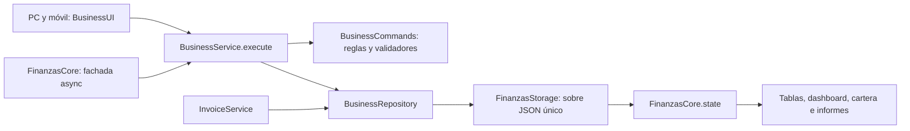

# Mi Negocio: auditoría e implementación funcional

Revisión del 9 de noviembre de 2026. Aplica a **PC y móvil**. No se cambió la tecnología principal: JavaScript sin framework y persistencia local del mismo origen.

Para abrirlo sin un servidor de desarrollo existente, desde la carpeta del proyecto puede ejecutar `python -m http.server 5500 --bind 127.0.0.1` y abrir `http://127.0.0.1:5500/desktop.html` o `http://127.0.0.1:5500/mobile.html`. Use el mismo origen/puerto para compartir datos. Las escrituras requieren localhost/HTTPS, Web Locks y Web Crypto; no use `file://`.

## Problemas encontrados antes de modificar

- Las páginas activas son `desktop.html` y `mobile.html`; sus controladores cargaban formularios y reglas empresariales duplicadas. Muchos otros archivos de vistas, C++/Qt y el SQL histórico no pertenecen al flujo web activo.
- En móvil, varias acciones rápidas solo mostraban mensajes de “registrado”, sin guardar nada. No había paridad para compras, productos, gastos, ingresos o ajustes.
- Los formularios de escritorio esperaban respuestas como `res.empleado` o `res.pago`, aunque algunos métodos devolvían objetos con otra estructura. Podían cerrar un formulario o mostrar éxito antes de comprobar persistencia.
- La lógica antigua modificaba el estado antes del guardado, dejando operaciones empresariales solo en memoria si fallaba `localStorage`.
- El flujo de caja tenía cuentas, ingresos y egresos fijos. El negocio nuevo recibía ventas, clientes, proveedores y existencias de demostración.
- El dashboard móvil restaba compras a los ingresos para estimar utilidad, en lugar del costo de los productos vendidos. Había diferencias con los informes y con el tratamiento de impuestos.
- Faltaban pagos de obligaciones a proveedores, edición/archivo de contactos, estados de empleados y acceso integrado a recetas/producción.
- Se podían eliminar registros con referencias históricas, actualizar atributos sin validar pertenencia al negocio y repetir acciones sin una clave persistente.
- La campana empresarial llevaba al plan personal y los enlaces de cambio PC/móvil no conservaban explícitamente la modalidad.

## Funciones implementadas

| Área | Operaciones verificables |
| --- | --- |
| Inicio | Indicadores calculados de ventas netas, ingresos, costos/gastos, utilidad, cartera, obligaciones, productos, inventario bajo, clientes y facturas; gráfico de ventas, ingresos y gastos; selector de período/negocio |
| Inventario | Alta, consulta, edición, SKU único, proveedor, precios y costos; entradas, salidas y ajuste absoluto; existencias no negativas y kardex |
| Ventas | Cliente/productos existentes, múltiples líneas, descuentos, impuestos, pago inicial, crédito, vencimiento, historial y comprobante interno imprimible |
| Facturación simulada | Conserva borradores editables, validación interna, PDF/XML/QR y notas crédito/débito; utiliza el mismo repositorio y bloqueo que las ventas ordinarias |
| Compras | Proveedor/productos existentes, detalles y snapshots, descuentos/impuestos, costo promedio ponderado, pago inicial y obligaciones |
| Contactos | Alta, consulta, edición, búsqueda y archivo de clientes/proveedores; se impiden identificaciones duplicadas y se conservan operaciones históricas |
| Movimientos | Otros ingresos, gastos por categoría/proveedor, consulta, edición administrativa y anulación trazable; cobros/pagos separados del resultado económico |
| Cuentas pendientes | Cartera y obligaciones de compras/gastos, pagos parciales/completos, vencimientos e historial; rechazo de sobrepagos |
| Empleados | Alta, edición, consulta, estados activo/inactivo/archivado y pagos administrativos con comprobante e historial |
| Producción | Recetas con insumos, validación acumulada de stock, fabricación, costo histórico y snapshot de receta; no consume insumos al fallar |
| Gestión | Edición y creación de negocios, cambio de negocio sin mezclar registros y eliminación únicamente sin historial empresarial |
| Interfaz | Búsqueda, filtros, paginación, CSV, consulta, cancelar/cerrar, impresión, acciones rápidas y alertas reales en ambas versiones |

Una venta confirmada no se edita silenciosamente: se conserva y se corrige mediante anulación; las facturas simuladas usan notas. Los borradores se gestionan en Facturación simulada. Las compras solo se anulan si existe mercancía suficiente para devolver y el costo se puede conciliar. No se eliminan movimientos financieros confirmados para ocultar su historial.

## Persistencia y sincronización

Se mantiene **una sola clave**: `FINANZAS_ETAPA_DATA_V2`. No hay una segunda base ni una copia paralela de las operaciones. El sobre general conserva su compatibilidad; el esquema empresarial lleva `businessSchemaVersion: 1` y una bitácora `businessLedger`.



Cada escritura empresarial:

1. Valida la modalidad, negocio, permiso local y datos del comando.
2. Obtiene el bloqueo compartido de Web Locks del mismo origen. Ventas, compras, pagos, producción e invoicing usan el mismo bloqueo.
3. Refresca la revisión persistida y prepara una copia candidata. La mutación no contiene llamadas de red ni esperas dentro del bloqueo.
4. Valida referencias, stock, importes, saldos, identificadores y documentos de facturación.
5. Incluye la operación, sus efectos, clave de idempotencia y auditoría en el mismo sobre.
6. Escribe con `localStorage.setItem` y comprueba la lectura posterior.
7. Solo después publica el estado y notifica a los controladores. Los formularios esperan el resultado antes de cerrar o anunciar éxito.

Ante un error no se publica un agregado parcial, ni se deja una operación empresarial fallida en una cola de guardado oculta. El formulario conserva sus campos y su clave para reintentar. Una repetición con la misma clave y contenido devuelve el resultado existente; cambiar el contenido de una clave ya utilizada se rechaza. La huella SHA-256 es de idempotencia, no un identificador fiscal.

`storage` y `BroadcastChannel` conservan la sincronización entre pestañas del mismo navegador y origen. Cada operación confirmada actualiza inmediatamente los lectores, y los datos se recuperan al recargar. La selección de negocio cambia todas las secciones y limpia los filtros de consulta. Los formularios abiertos comprueban el negocio capturado y los catálogos usan revisiones optimistas para detectar ediciones obsoletas.

Las escrituras empresariales de la fachada ahora devuelven **Promise** y un resultado con `ok`, `error` y `persistence`. Sus consumidores deben usar `await`. Las entradas activas se actualizaron y los formularios duplicados antiguos dejaron de cargarse. Los archivos históricos no activos se conservan por compatibilidad y no deben volver a cargarse como escritores alternativos.

## Migraciones y conservación del historial

- Un negocio nuevo empieza sin operaciones ni saldos inventados. “Mi negocio” es únicamente el nombre inicial editable de su espacio.
- Se conservan los registros existentes; no se borran automáticamente datos antiguos, incluidos los que el usuario hubiera guardado desde una versión con demostraciones.
- Se agregan las colecciones y metadatos empresariales faltantes sin tocar las colecciones personales.
- La precisión binaria excesiva heredada se normaliza con HALF_UP: importes a dos decimales y cantidades/costos/precios unitarios a cuatro. Los valores modificados quedan conservados en `legacyPrecisionOriginal` para su revisión en la copia JSON. Los documentos históricos del módulo de facturación mantienen sus propias cadenas decimales.
- Los nuevos registros usan UUID y relaciones al mismo negocio. Clientes, proveedores, productos, empleados y recetas con historial se archivan; los registros sin relaciones se pueden eliminar.
- Las ventas y compras incluyen detalles históricos; facturas, lotes y pagos conservan sus snapshots. Los cambios del catálogo no reescriben las descripciones o precios históricos.
- Las copias JSON incluyen la bitácora, pagos, devoluciones, recetas y relaciones. La restauración rechaza colecciones, identificadores, referencias o saldos nuevos inconsistentes antes de escribir.

## Reglas de cálculo

- La lógica de las nuevas operaciones usa enteros escalados `BigInt` y HALF_UP. Cantidades y precios/costos unitarios: hasta cuatro decimales. Importes: centavos COP.
- Los descuentos y los impuestos se calculan por línea con el motor compartido de facturación. Los resultados finales se convierten a `Number` en la frontera de compatibilidad de las colecciones/vistas, sin usar esa conversión para multiplicar o acumular los importes de la operación.
- La utilidad usa ventas netas sin impuestos más otros ingresos, menos costo histórico vendido, gastos y pagos administrativos a empleados. Las compras de inventario no se vuelven a sumar como gasto; los cobros de cartera no duplican ingresos.
- Las compras actualizan el costo unitario promedio ponderado con el importe neto de descuento. La anulación conserva snapshots de costo y comprueba cantidades/valoraciones antes de revertir inventario. Las devoluciones de ventas incorporan el costo histórico devuelto.
- La caja muestra exclusivamente cobros, pagos y reversiones registrados o identificables como pagos históricos. No incluye un saldo bancario inicial ficticio ni se presenta como conciliación bancaria.
- La cartera y las obligaciones muestran saldos actuales; los resultados se filtran por período. Las notas ajustan el resultado de la venta original, como se documentó en la facturación simulada; no se implementó un libro contable fiscal por eventos.

## Archivos principales

| Archivo | Cambio |
| --- | --- |
| `src/domains/business/businessCommands.js` | Reglas empresariales, validadores, CRUD, compras, ventas, pagos, costos, anulaciones y producción |
| `src/services/businessService.js` | Permisos locales, coordinación, idempotencia y auditoría |
| `src/storage/businessRepository.js` | Unidad de trabajo común y publicación después del guardado |
| `src/domains/business/businessSchema.js` | Versionado, migración y validación de referencias/saldos |
| `src/domains/business/readModel.js` | Lecturas consistentes para todas las pantallas |
| `src/ui/views/business/businessWorkspace.js` | Formularios, tablas/tarjetas, consultas, filtros, paginación, CSV, comprobantes y alertas compartidas |
| `styles/businessWorkspace.css` | Diseño responsivo, sidebar compacto, formularios y tarjetas móviles |
| `src/services/finanzasCore.js` | Fachada con delegación empresarial asíncrona; conserva los métodos personales |
| `src/storage/localStorage.js`, `migrations.js`, `demoData.js` | Lectura verificable, migración y negocio inicial sin demostraciones financieras |
| `src/domains/business/cashFlowDomain.js`, `metricsDomain.js`, `reportsDomain.js` | Eliminación de caja fija y criterios coherentes entre dashboard e informes |
| `src/invoicing/repository.js`, `service.js`, `ui.js` | Repositorio compartido, exclusión de catálogos archivados y actualización de revisiones/costos |
| `src/utils/desktop.js`, `mobile.js` | Eliminación de controladores empresariales duplicados; navegación y acciones reales, conservando lo personal |
| `desktop.html`, `mobile.html` | Vistas empresariales compartidas, nueva Gestión y orden de carga; se retiran formularios y escritores antiguos activos |
| `src/services/exportService.js`, `src/ui/shared/persistenceStatus.js` | Validación de copias y aviso que distingue un cambio personal pendiente de una operación empresarial rechazada |
| `src/ui/views/business/businessReportsView.js`, `styles/businessReports.css` | Reutilización de gráficos reales y legibilidad de ejes en móvil |
| `tests/business-workspace.test.cjs`, `business-workspace.browser.cjs`, `helpers/browser-core.cjs` | Cobertura funcional, persistencia, concurrencia y navegador |

Las suites existentes del núcleo y de facturación también se actualizaron para esperar las escrituras asíncronas y verificar rollback empresarial, en lugar de considerar exitoso un guardado solo en memoria.

## Verificación ejecutada

```sh
node --test tests/*.test.cjs
node test_shared.js
node test_dates.js
```

Resultado: **46 pruebas automatizadas aprobadas**, más las dos verificaciones históricas aprobadas.

```sh
node tests/business-workspace.browser.cjs
node tests/invoicing.browser.cjs
node tests/business-reports.browser.cjs
```

Las suites de navegador requieren Playwright; pueden usar `PLAYWRIGHT_MODULE` y `PLAYWRIGHT_CHROME` de una instalación externa. Trabajan con un servidor temporal y contextos aislados, sin modificar los datos del navegador del usuario. Capturas y archivos de verificación quedan en `tmp/`, ignorado por Git.

- Se comprobaron ambas páginas a **320, 375, 390, 768, 1024, 1366 y 1920 px**: 14 escenarios de vistas y formularios, navegación y ausencia de desbordamiento del contenido.
- El recorrido funcional completo en PC/móvil usa formularios reales: contactos, producto, compra, venta con descuento/impuesto, pagos, gastos, ingreso, empleado, pago a empleado, receta, producción, cambio/creación de negocio, alertas, edición, archivo, búsqueda, paginación, CSV, comprobante, recarga y fallo/reintento de almacenamiento.
- Se mantienen las regresiones de facturación, notas, QR, PDF/XML e informes. La prueba concurrente verifica que una factura y una venta ordinaria no consuman dos veces la última existencia.
- Se revisaron capturas de pantallas grandes y estrechas. Los gráficos empresariales funcionan con la red externa bloqueada.

## Alcance local y pendientes explícitos

1. **Backend/MySQL, autenticación y sincronización entre equipos**: no hay servidor ni credenciales configurados. El resultado actual es persistencia real local del mismo origen, no una base remota. El contrato `BusinessService.execute(action, data, operationKey)` y el repositorio central son los puntos de migración.
2. Para MySQL: implementar una API autenticada que valide el negocio del usuario y ejecute los comandos en una transacción; usar `DECIMAL`, claves foráneas del mismo negocio, índices únicos de operación/consecutivo y bloqueo de filas de inventario. La UI puede conservar su contrato de comandos. No aceptar un estado arbitrario del cliente como actualización de la base.
3. **Límite de concurrencia del navegador**: todas las escrituras empresariales activas y la facturación comparten Web Locks. Los guardados personales y la restauración general conservan sus flujos existentes; la comparación de revisiones no equivale a compare-and-swap transaccional frente a cualquier escritor. No hay garantía de serialización global multiusuario ni durabilidad de servidor frente a fallos del equipo o borrado del almacenamiento.
4. **Permisos locales**: los roles y la lista de negocios se verifican en el servicio, pero son configuraciones del navegador. No sustituyen autenticación/autorización del servidor ni una auditoría inalterable.
5. **DIAN real y nómina legal**: no están implementadas ni se simula su cumplimiento. La facturación sigue identificada sin validez fiscal y el proveedor real permanece deshabilitado. Los empleados tienen gestión administrativa y pagos, sin liquidación legal de nómina.
6. No se implementó devolución física parcial de compras ni un libro contable fiscal de ajustes por período. Las correcciones disponibles son las anulaciones comprobadas y las notas simuladas indicadas en cada flujo.


## Ampliación de informes — 10 de noviembre de 2026

La vista compartida de **Informes** incorpora ventas netas, impuestos, costo vendido, ganancia bruta de ventas, gastos empresariales y pagos administrativos al personal por separado. La ganancia bruta se calcula como ventas netas menos costo de productos vendidos; los otros ingresos se incorporan al resultado neto, sin inflar la ganancia bruta de ventas.

Se añadieron detalles de cada venta (fecha, número, cliente, base, costo, ganancia bruta, impuestos y total), de gastos/personal y de otros ingresos. Las operaciones anuladas y los datos de otros negocios quedan excluidos. El CSV y la impresión contienen estos detalles y el mismo filtro aplicado.

El selector **Elegir fechas** permite un rango inclusivo con validación y botón **Aplicar fechas**. Si la entrada es inválida, se conserva el último informe aplicado. La evolución de seis meses es un contexto de meses completos, identificado expresamente en pantalla y CSV; las tarjetas y el detalle respetan el rango elegido.

Se muestran cobros, pagos y flujo neto del período utilizando el mismo libro de caja del dashboard. La cartera, las obligaciones y el inventario al costo se identifican como saldos actuales de todos los períodos. Las compras de inventario y los cobros de cartera no duplican los gastos ni los ingresos del resultado.

El diseño se adapta al ancho real del panel mediante consultas de contenedor: tablas convertidas en tarjetas en paneles estrechos y tarjetas financieras en una columna cuando sea necesario, tanto en PC como en móvil. Se revisó la impresión A4.

Verificación de esta ampliación: **49 pruebas automatizadas**, verificaciones históricas de fechas/estado y **14 escenarios de navegador** (PC y móvil en 320, 375, 390, 768, 1024, 1366 y 1920 px), con filtros personalizados, fechas inválidas, detalle, CSV, impresión, gráficos sin red y separación del módulo personal.


## Organización integral del informe — 10 de noviembre de 2026

La captura de Gestión evidenciaba referencias UUID extensas, cantidades partidas en varias líneas, compras con estado genérico y consultas distribuidas entre secciones. El informe se organizó en siete vistas accesibles: **Resumen, Ventas, Gastos e ingresos, Compras, Cuentas pendientes, Personal y operación, Cobros y pagos**. Las pestañas admiten teclado y desplazamiento horizontal en pantallas estrechas; las tablas pasan a tarjetas en móvil.

### Información incorporada

- Compras del período: proveedor, referencia, fecha, total, pagado a la fecha, saldo actual y estado de pago. Se excluyen anuladas del resultado y se informa su cantidad.
- Cartera y obligaciones actuales: documento, contacto, vencimiento, saldo y situación, con documentos vencidos primero. Se advierte si la cartera histórica de clientes no coincide con los documentos detallados.
- Personal actual y pagos del período; lotes fabricados y sus costos; inventario actual al costo y alertas.
- Libro de cobros y pagos del período. Los pagos iniciales y posteriores comparten la misma proyección de caja, sin duplicar ingresos ni gastos.
- Acciones reales desde el informe: consulta del documento, registro de pago, comprobante y anulación de compras con motivo y confirmación. Reutilizan `BusinessUI` y `BusinessService`, con sus validaciones, bloqueo y publicación posterior al guardado.
- CSV e impresión incluyen todas las secciones, aunque una sola esté visible en pantalla.

### Persistencia comprobada

Los documentos siguen en la única clave `FINANZAS_ETAPA_DATA_V2`. El informe es una lectura del estado del negocio, sin una copia financiera adicional. **Guardar vista** conserva período, rango aplicado y sección en `negocios[].reportPreferences`, con validación versionada, idempotencia, auditoría y la misma unidad de trabajo del resto del negocio. Solo anuncia éxito después del guardado verificable. Un fallo conserva la configuración anterior; cambiar de negocio carga sus propias preferencias. Las preferencias se incluyen en las copias JSON.

Se probaron recarga y apertura de la otra versión PC/móvil en el mismo origen, errores de almacenamiento, doble clic y aislamiento entre negocios. La persistencia es local del navegador: no añade sincronización entre dispositivos ni un servidor remoto.

### Decisiones de la revisión de Mi Negocio

- Gestión conserva los formularios y la administración de operaciones; incorpora un acceso al informe de su sección. No se duplicaron reglas financieras ni escritores.
- Las referencias UUID se abrevian solo para su presentación; el identificador completo y las relaciones originales permanecen intactos.
- El estado de pago del informe distingue pagada, parcial, pendiente y vencida; el estado original del documento se conserva.
- Se retiró la tarjeta de cartera repetida en el resumen y la carga de tres dominios antiguos sin consumidores activos (`salesDomain`, `productionDomain`, `expensesDomain`). Los archivos históricos permanecen en el repositorio.
- La eliminación de negocios solo se ofrece cuando hay más de uno y el seleccionado no tiene historial. Las restricciones del servicio siguen siendo obligatorias.
- Se conservan Finanzas Personales, los formularios de negocio, los snapshots históricos y la facturación simulada. La autenticación de servidor, MySQL y la paginación de consultas remotas para grandes volúmenes requieren una etapa de backend.

### Archivos y verificación

Nuevos módulos compartidos: `reportPreferences.js`, `reportOperationsDomain.js` y `businessReportOperationsView.js`. Se integran en `reportsDomain.js`, `businessReportsView.js`, `businessCommands.js`, `businessService.js`, `businessSchema.js`, `businessWorkspace.js`, ambos HTML y sus hojas de estilo.

Resultado: **52 pruebas automatizadas**, verificaciones históricas de estado/fechas y **28 escenarios de navegador**: 14 del informe y 14 del espacio empresarial, en ambas páginas a 320, 375, 390, 768, 1024, 1366 y 1920 px. Los recorridos completos comprueban además pagos desde el informe sin duplicados, fallo/reintento de preferencias, recuperación tras recarga y consistencia entre PC/móvil.
